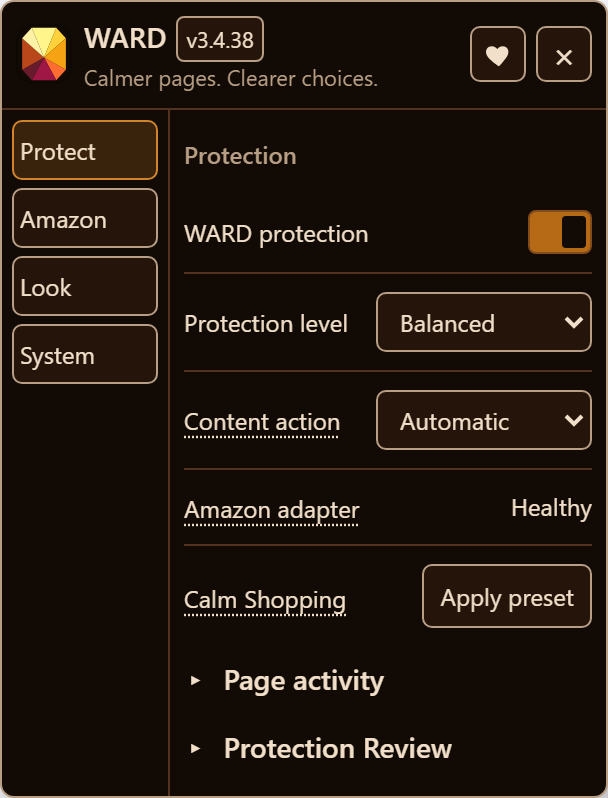
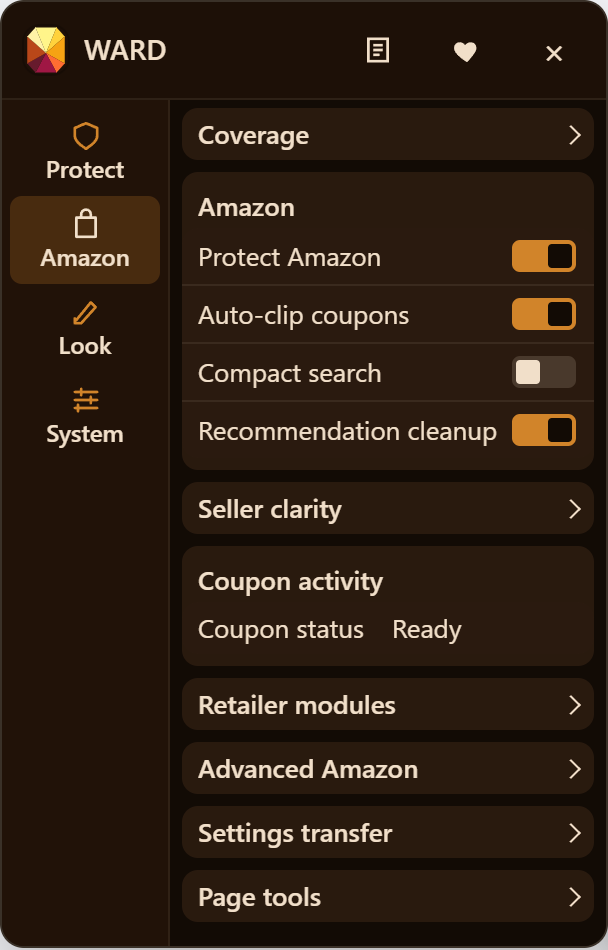
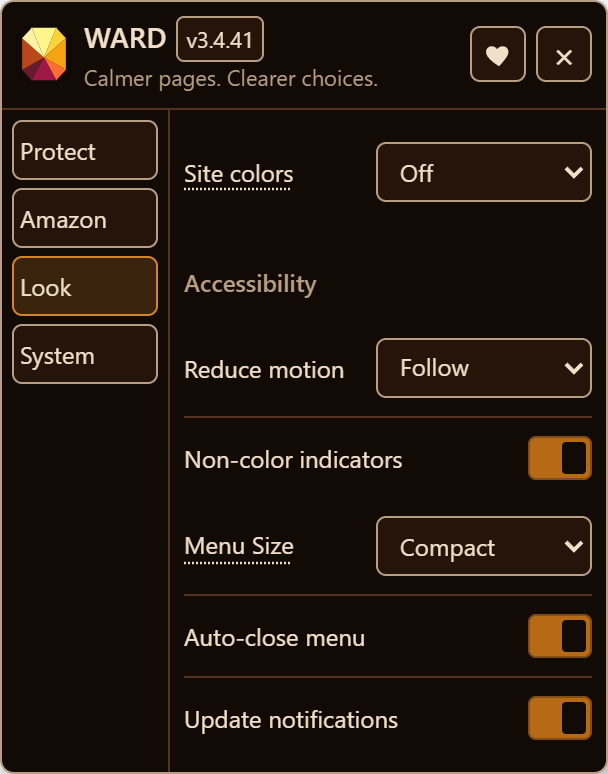

# WARD

**Calmer pages. Clearer choices.**

## Get started

1. Install a userscript manager such as [Violentmonkey](https://violentmonkey.github.io/get-it/) or [Tampermonkey](https://www.tampermonkey.net/).
2. [Install WARD](https://github.com/ExtraPotions/WARD/releases/latest/download/ward.user.js) and confirm in your userscript manager.
3. Refresh a supported store and open the WARD launcher. With other ExtraPotions products installed, they share one launcher: open it and choose WARD.

## What you can do

- **Choose site colors:** pick a palette in **Look → Site colors** to recolor supported stores: Obsidian, or Default, Indigo, Blue, Green, Red or Gray, which follow your system light or dark mode. Page surfaces, navigation, forms and neutral controls use the chosen palette. Product photos and promotional artwork retain their colors; text, details panels and review fades follow the surface beneath them. Purchase and status colors remain meaningful. Off restores the site's colors.
- **Calm the page:** hide or dim sponsored placements, upsells, urgency messages, and pushy recommendations at the level you choose. Essential purchasing information stays visible.
- **Shop six stores and Shopify shops:** Amazon, eBay, Etsy, Walmart, Target, Best Buy, and any store built on Shopify, each with its own controls. On Shopify stores, WARD hides email sign-up pop-ups and dims announcement bars.
- **Undo changes:** reveal hidden content, allow a pattern on a page, or pause WARD entirely.
- **See who you're buying from:** on Amazon, view the brand, seller, and fulfillment, with optional hints about unusual sellers or ratings. These hints stay on your device and don't judge quality or authenticity.
- **Clip coupons:** optionally clip eligible coupons automatically.

## See it in action

<table>
  <tr>
    <td width="50%" valign="top" align="center"> <strong>Protection level and content action</strong></td>
    <td width="50%" valign="top" align="center"> <strong>Amazon coverage and options</strong></td>
  </tr>
</table>

Screenshots use sample content.

All ExtraPotions menus share the same Core template. Open **System** for status, diagnostics, troubleshooting and Reset. Donations remain in the header heart.

## Support

[Support development](https://ko-fi.com/expdare). Donations are optional. All features remain available without donating.

## License

**Code:** [PolyForm Noncommercial License 1.0.0](LICENSE-CODE.md) 
**Artwork and documentation:** [CC BY-NC-SA 4.0](LICENSE-ASSETS.md)

WARD is an independent project and is not affiliated with or endorsed by the retailers where it is used.
