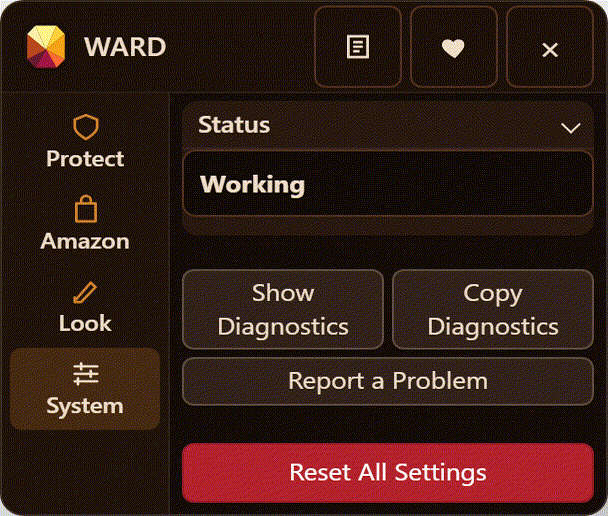

#  WARD

Hide or dim sponsored placements, upsells and urgency messages on supported stores.

[Install WARD](https://github.com/ExtraPotions/WARD/releases/latest/download/ward.user.js) · Requires [Violentmonkey](https://violentmonkey.github.io/get-it/) or [Tampermonkey](https://www.tampermonkey.net/).

After installing, refresh a supported store and open the WARD gem. [Setup and controls →](docs/usage.md)

## Features

- Choose protection levels and controls for each store.
- Reveal hidden content, allow a pattern or pause WARD.
- Recolor store pages while preserving product photos and purchase information.
- Review Amazon seller details and optionally clip eligible coupons.

Supports Amazon, eBay, Etsy, Walmart, Target, Best Buy and Shopify stores. Essential purchasing information stays visible; seller hints do not judge quality or authenticity.

## See it in action

More screenshots

Screenshots use sample content.

---

[Usage](docs/usage.md) · [Changelog](CHANGELOG.md) · [Support](https://ko-fi.com/expdare) · [Code license](LICENSE-CODE.md) · [Artwork and documentation license](LICENSE-ASSETS.md)

Donations are optional. All features remain available without donating.

WARD is independent and is not affiliated with or endorsed by the retailers where it is used.
